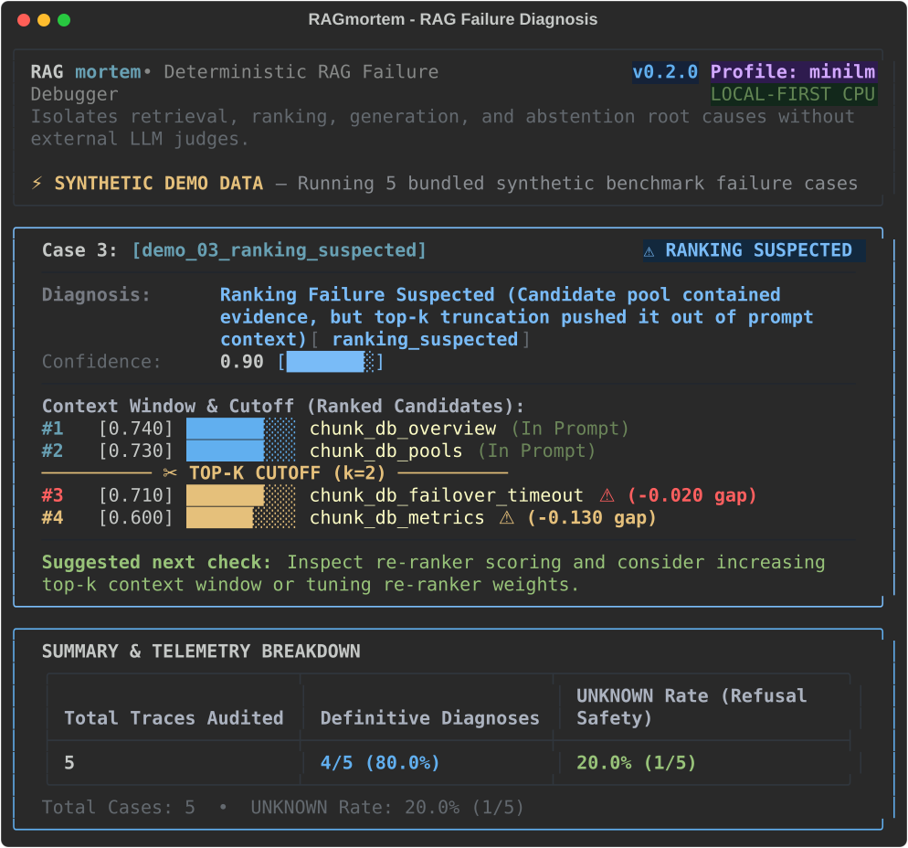

# RAGmortem

[](https://pypi.org/project/ragmortem/)
[](https://pypi.org/project/ragmortem/)
[](tests/)
[](LICENSE)

A local-first, deterministic root-cause failure debugger for RAG pipelines. It isolates retrieval misses, ranking truncation, generation hallucinations or ignored context, and unanswerable queries — 100% on CPU, offline, with zero external LLM judges or API keys.

```bash
uvx ragmortem demo
```



> **Project Status: Open-source RAG debugger (v0.2.0)**  
> RAGmortem isolates component root causes across retrieval, ranking, generation, and abstention from execution telemetry. Features include a Rich terminal UI with visual candidate-cutoff meters, four calibration profiles (`minilm`, `openai`, `bge`, `relative`), two-tier answer verification (lexical + local NLI), 1-line LangChain/LlamaIndex callbacks, a `pytest-ragmortem` CI plugin, and validation on the public SQuAD v1.1 dataset.

```python
from ragmortem import diagnose, Chunk

# 20-second quickstart: diagnose an execution trace directly
result = diagnose(
    query="What is the response time SLA for a P1 incident?",
    retrieved_chunks=[{"id": "doc_dr", "text": "Disaster recovery drills occur quarterly.", "score": 0.14}],
    answer="Engineers must run quarterly disaster recovery exercises.",
    corpus=[
        Chunk(id="chunk_incident_severity_p1", text="For P1 critical incidents, the engineering response time SLA is 15 minutes.", source="policy"),
        Chunk(id="chunk_dr_drill", text="Disaster recovery drills occur quarterly.", source="policy"),
    ],
    mode="corpus_aware",
)

print(result.to_text())
```

Output:
```text
Failure: RETRIEVAL_SUSPECTED (suspected)
Evidence Score: 0.95

Why:
The answer becomes supported when the missing high-relevance chunk is available, but the relevant chunk was absent from the retrieved top-k results.

Evidence:
  * Retriever returned low-relevance chunks at runtime (top score: 0.140).
  * Corpus audit shows indexed documents exist with high relevance to question.
  * Corpus contains candidate 'chunk_incident_severity_p1' with distinct semantic relevance (score: 0.833, gap: 0.563) and high entity alignment (4/4 key terms matched).
  * Root cause (suspected): Retriever failed to locate relevant documents present in the corpus.

Recommended next step:
Increase retrieval recall: inspect query reformulation, adjust embedding/indexing strategy, or expand candidate retrieval pool.

Mode: corpus_aware
Limitations:
  * Candidate pool prior to top-k truncation was not logged in trace.
```

---

## 1. What Problem RAGmortem Solves

When a RAG system returns an incorrect answer, traditional observability tools only compute continuous quality scores (e.g. `faithfulness: 0.42`). Continuous scores tell you *that* something went wrong, but never **which component broke**:
- **Did the retriever fail to find the document?** (`retrieval_miss`)
- **Did the candidate retriever find it, but the re-ranker cut it below top-k?** (`ranking_miss`)
- **Did the generator receive the correct context, but hallucinate or ignore it?** (`generation_ignored_context`)
- **Was the question unanswerable from the knowledge base, but the model answered anyway?** (`should_abstain`)
- **Is runtime telemetry insufficient to distinguish the cause?** (`unknown`)

RAGmortem replaces ambiguous scores with deterministic, reproducible root-cause attribution and concrete next-step remediation actions.

---

## 2. Privacy & Data Safety

RAGmortem is built as a local-first developer debugging tool:

* **Zero Telemetry**: No tracking, no external analytics, no telemetry platform integration.
* **No Network Calls**: Diagnostic evaluation executes 100% locally on your CPU.
* **No Stored API Keys**: Diagnoser does not require, store, or transmit LLM API keys.
* **No Prompts/Answers Uploaded**: Your data stays on your machine.
* **No Automatic Sensitive Logging**: Document texts and queries are evaluated in-memory. Local trace persistence is strictly opt-in.

---

## 3. How It Works

RAGmortem uses an uncertainty-aware decision tree operating on observable execution telemetry:

1. **Telemetry Completeness Check**: Validates that query, answer, context, and similarity scores are present. Missing telemetry directly produces `UNKNOWN` rather than fabricated certainty.
2. **Score Calibration Engine**: Normalizes score distributions across embedding spaces (`minilm`, `openai`, `bge`, or runtime empirical `relative` auto-calibration) to prevent threshold skew.
3. **Abstention & Refusal Probe**: Detects whether the generator emitted a refusal. If low retrieval score matches refusal, marks `NO_FAILURE` (appropriate abstention). If context had strong scores, marks false refusal.
4. **Candidate Cutoff Probe**: Inspects the candidate retrieval pool prior to top-k truncation. If a viable candidate exists immediately below the cutoff ($\text{score gap} \le 0.08$), isolates a `RANKING_SUSPECTED` failure.
5. **Context Score & Grounding Probe**: High similarity in context with an ungrounded or contradictory answer isolates `GENERATION_SUSPECTED`.
6. **Two-Tier Answer Verification Stack**:
   - *Tier 1 (Default)*: Fast, deterministic token subsequence containment (CPU-only, zero dependencies).
   - *Tier 2 (Semantic)*: Local NLI cross-encoder verification via `pip install "ragmortem[local-nli]"` for paraphrased and synonymous answers without external LLM judges.
7. **Corpus Audit vs. Trace-Only Boundary**:
   - In `corpus_aware` mode, audits the corpus index to distinguish whether documents were missed (`RETRIEVAL_SUSPECTED`) or the question was unanswerable (`ABSTENTION_SUSPECTED`).
   - In `trace_only` mode, safely returns `UNKNOWN` because an APM trace without corpus access cannot infer document existence.

---

## 4. Installation & Quickstart

Requires **Python >= 3.11**.

### Zero-Friction Instant CLI (No Installation Needed)

Run the bundled failure demonstration immediately using `uvx`:
```bash
uvx ragmortem demo
```

Inspect input trace schema and full JSON format:
```bash
uvx ragmortem schema
```

### Install from PyPI

```bash
pip install ragmortem
```

For fast local NLI / cross-encoder semantic answer verification:
```bash
pip install "ragmortem[local-nli]"
```

Or install from GitHub:
```bash
pip install git+https://github.com/deveshkolte/RAGmortem.git
```

Or for local development:
```bash
git clone https://github.com/deveshkolte/RAGmortem.git
cd RAGmortem
pip install -e ".[dev,local-nli]"
```

### CLI Quickstart

Check version:
```bash
ragmortem --version
```

Run the bundled demonstration on 5 synthetic failure cases with the Rich terminal UI:
```bash
ragmortem demo

# Switch embedding calibration profile (minilm, openai, bge, relative)
ragmortem demo --profile relative

# Export report directly to SVG for documentation or pull requests
ragmortem demo --out docs/hero.svg
```

View input trace schema with interactive Rich syntax highlighting:
```bash
ragmortem schema
```

Diagnose execution traces from the terminal:
```bash
# Trace-only diagnosis with Rich terminal UI
ragmortem diagnose sample_failure.json

# Calibrate to your embedding model distribution
ragmortem diagnose trace.json --profile openai    # text-embedding-3-small/large
ragmortem diagnose trace.json --profile bge       # bge-large-en-v1.5
ragmortem diagnose trace.json --profile relative  # auto-calibrate to runtime score distribution

# Corpus-aware diagnosis (auditing markdown documents or index)
ragmortem diagnose traces.jsonl --corpus path/to/documents

# Multi-format reporting: HTML (dark-mode dashboard), structured JSON, or clean Markdown
ragmortem diagnose trace.json --format html --out report.html
ragmortem diagnose trace.json --format md --out report.md
ragmortem diagnose trace.json --format json --out report.json
```

---

## 5. Standard Input Trace Schema

RAGmortem accepts traces as single JSON objects (`.json`), arrays of traces, or newline-delimited JSON (`.jsonl`).

Run `ragmortem schema` to view the specification, or inspect the standard structure below:

```json
{
  "id": "case_101",
  "question": "What is the mandatory engineering response time for a P1 incident?",
  "answer": "The response time for P1 incidents is 24 hours.",
  "retrieved": [
    {
      "chunk_id": "chunk_p1_sla",
      "text": "For Priority 1 (P1) critical incidents, the engineering response time SLA is 15 minutes.",
      "score": 0.88
    },
    {
      "chunk_id": "chunk_p2_sla",
      "text": "For Priority 2 (P2) major incidents, the response time is 2 hours.",
      "score": 0.52
    }
  ],
  "candidates": [
    {
      "chunk_id": "chunk_p1_sla",
      "text": "For Priority 1 (P1) critical incidents, the engineering response time SLA is 15 minutes.",
      "score": 0.88
    },
    {
      "chunk_id": "chunk_p2_sla",
      "text": "For Priority 2 (P2) major incidents, the response time is 2 hours.",
      "score": 0.52
    },
    {
      "chunk_id": "chunk_p3_sla",
      "text": "For Priority 3 (P3) minor incidents, the response time is 24 hours.",
      "score": 0.35
    }
  ],
  "top_k": 2,
  "reference_answer": "15 minutes",
  "score_type": "similarity"
}
```

### Schema Field Reference

| Field | Status | Type | Description |
| :--- | :--- | :--- | :--- |
| `id` | Optional | `string` | Unique trace or case identifier. |
| `question` | **Required** | `string` | User query or question (alias: `query`). |
| `answer` | **Required** | `string` | Answer produced by RAG pipeline (alias: `generated_answer`). |
| `retrieved` | **Required** | `list[dict]` | Chunks injected into the LLM context (alias: `retrieved_chunks`). |
| `retrieved[].chunk_id`| Optional | `string` | Unique chunk identifier (alias: `id`). |
| `retrieved[].text` | Optional | `string` | Text content of chunk (alias: `content`). |
| `retrieved[].score` | Optional | `float` | Relevance / similarity score. |
| `candidates` | Optional | `list[dict]` | Full candidate pool before top-k truncation (same shape as `retrieved`). Enables candidate-cliff ranking diagnosis. |
| `top_k` | Optional | `int` | Context window cutoff size. |
| `reference_answer` | Optional | `string` | Expected ground-truth answer for definitive reference-assisted verification. |
| `score_type` | Optional | `string` | `"similarity"` (default), `"cosine_distance"`, or `"distance"`. |

---

## 6. Python SDK Usage

### Trace Construction

Use `ragmortem.trace` to record runtime execution telemetry:

```python
from ragmortem import trace, diagnose

t = trace(
    query="What is the P1 incident response SLA?",
    retrieved_chunks=[
        {"id": "doc_dr", "text": "Disaster recovery drills occur quarterly.", "score": 0.14},
        {"id": "doc_sla", "text": "Communication cadence is bi-weekly.", "score": 0.12},
    ],
    scores=[0.14, 0.12],
    answer="Engineers must run quarterly disaster recovery exercises.",
    context="[1] Disaster recovery drills occur quarterly.\n[2] Communication cadence is bi-weekly.",
)
```

Missing fields are never silently fabricated (missing scores, context, or answer remain explicit).

### Diagnostic Operating Modes

RAGmortem supports three explicit **diagnostic scopes** (**never silently switches between them**):

| Scope | Mode Parameter | Corpus Required? | Reference Answer? | What It Verifies |
|-------|----------------|------------------|-------------------|------------------|
| **Trace-Only** | `trace_only` | No | No | Only observable telemetry (scores, refusal, candidate pool). Returns `UNKNOWN` when evidence is ambiguous. |
| **Corpus-Aware Observed** | `corpus_aware` (no `reference_answer`) | Yes | No | Heuristic diagnosis: retrieval/ranking/generation/abstention suspicions based on corpus audit. **Does not verify answer correctness.** |
| **Corpus-Aware Reference-Assisted** | `corpus_aware` + `reference_answer` | Yes | **Yes** | Definitive diagnosis: compares generated answer to reference, searches retrieved/candidate chunks for supporting evidence. Returns `NO_FAILURE`, `GENERATION_PROVEN`, `RETRIEVAL_MISS`, `RANKING_MISS`, `SHOULD_ABSTAIN`, or `UNKNOWN`. |

#### Trace-Only (Offline APM / Logs)
Zero knowledge-base dependencies. Evaluates observable trace telemetry directly:
```python
result = diagnose(t, mode="trace_only")
print(result.failure_type)        # FailureType.UNKNOWN (safely avoids guessing)
print(result.recommended_action) # Explains missing corpus access
```

#### Corpus-Aware (Knowledge Base Probing)
Probes the corpus index to disambiguate retrieval vs. answerability failures.
Accepts three input formats:

**1. Directory path of markdown files:**
```python
result = diagnose(t, corpus="path/to/markdown/documents", mode="corpus_aware")
```

**2. In-memory list of `Chunk` objects (or dicts):**
```python
from ragmortem import Chunk

corpus = [
    Chunk(id="doc_p1", text="For P1 critical incidents, the response time SLA is 15 minutes.", source="policy"),
    Chunk(id="doc_dr", text="Disaster recovery drills occur quarterly.", source="policy"),
]
result = diagnose(t, corpus=corpus, mode="corpus_aware")
```

**3. Custom retriever adapter (`.retrieve(query, k)`):**
```python
# Any object implementing .retrieve(query: str, k: int) -> tuple[list[Chunk], list[float]]
result = diagnose(t, corpus=my_custom_retriever, mode="corpus_aware")
```

**With reference answer (definitive diagnosis):**
```python
result = diagnose(
    t,
    corpus=corpus,
    mode="corpus_aware",
    reference_answer="15 minutes",
)
```

> **Key distinction**: Without `reference_answer`, `corpus_aware` mode uses **heuristics** (corpus audit + score thresholds) and returns *suspected* failure types (`GENERATION_SUSPECTED`, `RETRIEVAL_SUSPECTED`, etc.). It **cannot verify whether the generated answer is factually correct** — it only flags when high-relevance context was present but the answer may be wrong. With `reference_answer`, the diagnosis becomes *definitive* (`NO_FAILURE`, `GENERATION_PROVEN`, `RETRIEVAL_MISS`, etc.) by comparing the answer to the reference and searching the corpus for supporting evidence.

### Complete Integration Demonstrations

* [`examples/integrations/minimal_rag.py`](examples/integrations/minimal_rag.py): Minimal code integration across all 6 diagnostic scenarios.
* [`examples/integrations/realistic_rag_demo.py`](examples/integrations/realistic_rag_demo.py): End-to-end small RAG app smoke test (`documents → embeddings → retrieval → context → generator → RAGmortem`).

Run the demo locally:
```bash
python examples/integrations/realistic_rag_demo.py
```

---

## 7. Workflow Integrations (The Growth Wedge)

### 1-Line LangChain & LlamaIndex Callbacks

Drop RAGmortem directly into your existing chain or query engine with one line of code:

#### LangChain Callback
```python
from ragmortem import RAGmortemCallbackHandler

handler = RAGmortemCallbackHandler(auto_diagnose=True)
chain.invoke(
    {"query": "What is the P1 incident SLA?"},
    config={"callbacks": [handler]},
)
# Or manually inspect diagnosis:
result = handler.diagnose()
```

#### LlamaIndex Callback
```python
from ragmortem import LlamaIndexRAGmortemHandler
from llama_index.core.callbacks import CallbackManager
from llama_index.core import Settings

handler = LlamaIndexRAGmortemHandler(auto_diagnose=True)
Settings.callback_manager = CallbackManager([handler])

response = query_engine.query("What is the P1 incident SLA?")
result = handler.diagnose()
```

---

### Zero-Dependency Framework Adapters (`from_langchain` & `from_llamaindex`)

If you don't use callbacks or prefer to convert existing run objects, convert framework outputs or run dictionaries directly into standardized `Trace` instances with zero hard dependencies (neither `langchain` nor `llama-index` needs to be installed):

#### LangChain Adapter (`from_langchain`)
```python
from ragmortem import from_langchain, diagnose

# Duck-types RetrievalQA output dicts, chain.invoke() runs, or Document objects
run_output = chain.invoke({"query": "What is the P1 incident SLA?"})
trace_obj = from_langchain(run_output)

result = diagnose(trace_obj)
print(result.to_text())
```

#### LlamaIndex Adapter (`from_llamaindex`)
```python
from ragmortem import from_llamaindex, diagnose

# Duck-types Response / NodeWithScore objects or query engine output dicts
response = query_engine.query("What is the P1 incident SLA?")
trace_obj = from_llamaindex(response)

result = diagnose(trace_obj)
print(result.to_text())
```

---

### OpenTelemetry, Phoenix & LangSmith Trace Importers

Import traces directly from **Arize Phoenix**, **LangSmith**, or generic **OpenTelemetry** spans:

```bash
# Auto-detects schema and diagnoses directly
ragmortem diagnose phoenix_spans.json
ragmortem diagnose langsmith_run.json

# Or import into standardized RAGmortem trace format:
ragmortem import phoenix_spans.json --out trace.json --diagnose
```

In Python:
```python
from ragmortem import import_trace, diagnose

trace_obj = import_trace("path/to/otel_spans.json")
result = diagnose(trace_obj)
print(result.to_text())
```

---

### `pytest-ragmortem`: Auto-Diagnosis in CI & `ragmortem_assert`

RAGmortem includes a built-in pytest plugin (`pytest-ragmortem`) that intercepts test failures and isolates component root causes automatically:

#### 1. Explicit Assertion Helper (`ragmortem_assert`)
Assert that a RAG execution succeeded without failure. If any failure is diagnosed (`RETRIEVAL_SUSPECTED`, `RANKING_SUSPECTED`, `GENERATION_SUSPECTED`, etc.), it formats and prints a Rich diagnostic card and raises an `AssertionError` with remediation recommendations:

```python
from ragmortem import ragmortem_assert

def test_production_qa():
    run_output = my_rag_app.query("What is the mandatory P1 response SLA?")
    
    # Diagnoses trace; if failure detected, raises AssertionError with Rich diagnostic card
    ragmortem_assert(
        trace_input=run_output,
        reference_answer="15 minutes",
        profile="minilm",  # or "openai", "bge", "relative"
    )
```

#### 2. Automatic Diagnosis via `rag_trace` Fixture
When an ordinary unit test assertion fails in CI, `rag_trace` automatically intercepts the test failure, isolates the root cause from execution telemetry, and outputs a formatted failure card:

```python
# test_rag_pipeline.py
def test_p1_sla(rag_trace):
    res = rag_app.query("What is the P1 response time?")
    rag_trace.record(
        query="What is the P1 response time?",
        retrieved_chunks=res.retrieved_chunks,
        scores=res.scores,
        answer=res.answer,
    )
    # If this assertion fails, pytest-ragmortem automatically prints the root-cause diagnosis!
    assert "15 minutes" in res.answer
```

In **GitHub Actions**, `pytest-ragmortem` automatically:
1. Emits inline workflow annotations (`::error file=...,title=RAGmortem Diagnosis [GENERATION_SUSPECTED]...`)
2. Generates an executive diagnostic table in `$GITHUB_STEP_SUMMARY`.

---

## 8. Failure Taxonomy

| Failure Mode | Canonical Type | What Happened | Recommended Next Step |
| :--- | :--- | :--- | :--- |
| **`retrieval_suspected`** | `retrieval_miss` | Supporting chunk exists in corpus but was omitted from candidate set. | Increase retrieval recall, adjust embedding model, or expand candidate pool. |
| **`ranking_suspected`** | `ranking_miss` | Supporting chunk was retrieved in candidates, but fell below top-k cutoff. | Tune re-ranker, expand context window (top-k), or re-score candidates. |
| **`generation_suspected`** | `generation_ignored_context` | High-relevance context was in prompt, but generator hallucinated or ignored it. **Observed mode only — suspected, not proven.** | Tighten prompt grounding constraints, lower temperature, refine prompt. |
| **`abstention_suspected`** | `should_abstain` | Corpus contains no supporting evidence, but generator fabricated an answer. | Add strict refusal instructions for out-of-domain queries; filter low scores. |
| **`unknown`** | `unknown` | Telemetry is incomplete (missing scores, dropped candidates) or signals are ambiguous. | Provide complete telemetry or supply corpus index access. |
| **`no_failure`** | `no_failure` | **Reference-assisted mode only**: Answer is verified grounded, or system correctly refused unanswerable question. | No corrective action required. |
| **`generation_proven`** | `generation_ignored_context` | **Reference-assisted mode only**: Reference answer found in retrieved context, but generator produced a different answer. | Tighten prompt grounding constraints, lower temperature, refine prompt. |
| **`retrieval_miss`** | `retrieval_miss` | **Reference-assisted mode only**: Reference answer exists in corpus but was not retrieved. | Increase retrieval recall, adjust embedding model, or expand candidate pool. |
| **`ranking_miss`** | `ranking_miss` | **Reference-assisted mode only**: Reference answer found in candidate pool but ranked below top-k. | Tune re-ranker, expand context window (top-k), or re-score candidates. |
| **`should_abstain`** | `should_abstain` | **Reference-assisted mode only**: Reference answer not in corpus; system should have abstained. | Add strict refusal instructions; filter low scores. |

> **Note**: `generation_suspected`, `retrieval_suspected`, `abstention_suspected`, `ranking_suspected` are **heuristic suspicions** returned by observed modes (trace-only and corpus-aware without `reference_answer`). The definitive types `generation_proven`, `retrieval_miss`, `ranking_miss`, `should_abstain`, `no_failure` are only returned by reference-assisted mode (`corpus_aware` + `reference_answer`).

---

## 9. Validation Benchmarks & Historical Evidence

To ensure scientific credibility, RAGmortem distinguishes strictly between **controlled benchmarks**, **adversarial holdouts**, and **integration smoke tests**.

> **Important**: Controlled benchmark metrics do NOT represent real-world accuracy on uncurated production data.

| Evaluation Suite / Benchmark | Purpose | Corpus-Aware Accuracy | Trace-Only Accuracy | Unknown Recall | Key Findings |
| :--- | :--- | :---: | :---: | :---: | :--- |
| **Real-World Public Dataset Benchmark** (50 traces) | External data validity (SQuAD v1.1) | 100.0% (reference-assisted) | — | 0.0% UNKNOWN | Traces built from real SQuAD v1.1 questions and Wikipedia passages, not project-generated fixtures. Top-k truncation accounted for 86.2% of genuine retrieval failures. |
| **Day 5 Controlled In-Sample** (122 cases) | Development baseline | 100.0% (122/122) | N/A | N/A | Verified taxonomy and heuristic logic coherence under ideal conditions. |
| **Day 6 Adversarial Holdout** (120 cases) | Cloud/DevOps holdout | 90.8% (109/120) | 58.3% (70/120) | 100.0% (20/20) | Exposed fixed-threshold brittleness; motivated uncertainty-aware scoring. |
| **Day 7/8 BioTrial Frozen Holdout** (100 cases) | Clinical trials holdout | 100.0% (frozen upper-bound) / 96.0% overall | 60.0% (50.0% resolved, 100% precision) | 100.0% (20/20) | 100% recall on ranking misses and generation failures. Trace-only safely refuses low-score ambiguity. |
| **Day 8 FinDebt Domain Holdout** (40 cases) | Complex corporate finance | 65.0% overall / 83.3% resolved | 7.5% (safely refuses) | 100.0% | Demonstrated that background terminology traps in specialized domains require lexical support analysis. |
| **Integration Smoke Test** (`realistic_rag_demo.py`) | End-to-end integration | Smoke validation | Smoke validation | Smoke validation | Proves public API usability in real Python code without synthetic fault injection. |

### 9.1 Real-World Benchmark Evidence (SQuAD v1.1)

The synthetic benchmarks above use labels generated by RAGmortem's own fault injector. To test validity on **external, non-synthetic data**, `benchmarks/run_real_eval.py` builds failure traces from the public [SQuAD v1.1 development set](https://rajpurkar.github.io/SQuAD-explorer/) (Rajpurkar et al., 2016, CC BY-SA 4.0): real Wikipedia passages, human-written questions, and known ground-truth answers.

Each of the 50 traces replays a deterministic BM25 retrieval run over a 16-passage corpus, a top-8 → top-3 candidate re-ranking, and a generated answer (a decoy answer from the same dataset; no LLM was called). Results, full methodology, and threats to validity are in [`benchmarks/REAL_WORLD_RESULTS.md`](benchmarks/REAL_WORLD_RESULTS.md).

Headline findings (reproduce offline with `python benchmarks/run_real_eval.py`):

* **Reference-assisted mode attributed 100% (50/50)** of traces to the correct component, with a **0% UNKNOWN rate** — cleanly separating ranking truncation, retrieval misses, and generator failures.
* **Top-k truncation dominates real retrieval failures.** Across 9,957 real questions, evidence reached the top-3 prompt in 96.9% of cases; among the 312 genuine retrieval failures, **86.2% were top-k candidate truncation** and only 13.8% were candidate-pool misses.
* **Observed mode (no reference answer) is conservative by design.** With flat real-world BM25 score tails, the candidate-cliff probe attributes 88% of traces to truncation and abstains/returns UNKNOWN on the rest — definitive attribution requires a reference answer.
* **Diagnosis is millisecond-scale**: median 0.19 ms per trace, CPU-only, no network or API calls.

---

## 10. What Each Mode Can Truthfully Claim

| Diagnostic Mode | What It Can Truthfully Claim | What It Cannot Claim |
| :--- | :--- | :--- |
| **`trace_only`** | Operates strictly on provided runtime telemetry (query, retrieved chunks, scores, candidates, answer). Flags candidate truncation (`RANKING_SUSPECTED`), high-score context ignored (`GENERATION_SUSPECTED`), and appropriate refusal (`NO_FAILURE`). | Cannot verify whether unretrieved documents exist in your corpus or if the answer is factually correct. When retrieval scores are low or borderline, it safely refuses to guess and outputs `UNKNOWN`. |
| **`corpus_aware`** | Audits your corpus index to determine if high-relevance documents exist for the query. Distinguishes retrieval misses (`RETRIEVAL_SUSPECTED`) from unanswerable queries (`ABSTENTION_SUSPECTED`), including terminology trap detection. | Cannot verify factual correctness of the generated answer without an expected reference answer. Diagnoses retrieval quality and grounding alignment, not semantic truth. |
| **`reference_assisted`** | Verifies correctness against a user-supplied reference answer using two-tier verification (lexical + local NLI). Determines if evidence was present in context (`GENERATION_PROVEN`), candidate pool (`RANKING_MISS`), broader corpus (`RETRIEVAL_MISS`), or absent (`SHOULD_ABSTAIN`). | Reference matching verifies alignment against the reference, not mathematical proof of reasoning. Paraphrased answers without `[local-nli]` installed rely on token subsequence matching. |
| **`oracle`** | Runs counterfactual replay isolating retriever vs. generator ceilings in controlled research benchmarks. | Cannot run on uncurated production traces without a known ground-truth gold chunk. |

---

## 11. Known Limitations

* **Embedding Distribution Calibration**: RAGmortem includes distribution-aware auto-calibration (`ScoreCalibrator`) supporting OpenAI (`text-embedding-3-small/large`), Cohere (`embed-v3`), BGE (`bge-large-en-v1.5`), and MiniLM baselines. When evaluating unknown embedding distributions, empirical distribution calibration (`--profile relative`) automatically analyzes observed candidate pools (mean, spread, z-scores) rather than relying exclusively on fixed thresholds.
* **Semantic Verification vs. Token Matching**: Answer verification defaults to fast deterministic token matching and seamlessly upgrades to local NLI / Cross-Encoder entailment verification when installed via `pip install "ragmortem[local-nli]"`, enabling robust semantic verification for paraphrased responses.
* **`GENERATION_PROVEN` Means Lexical Evidence, Not Proof**: The enum label `GENERATION_PROVEN` denotes that the reference answer text was verbatim contained within the retrieved context chunks, yet the generator failed to produce it. It does not represent formal mathematical or logical proof.
* **Counterfactual Replay Requires Gold Chunk**: Counterfactual replay only runs in `oracle` mode, which strictly requires a verified `gold_chunk_id`.
* **Synthetic Benchmark Labels in `evals/`**: Labels in the project's `evals/` datasets were generated by the project's own fault injector, so they share its assumptions. For validity on external data, see the [Real-World Benchmark Evidence](#91-real-world-benchmark-evidence-squad-v11) built on the public SQuAD v1.1 dataset (`benchmarks/`). No real-world **production outage** traces from a third-party deployment have been evaluated yet; the SQuAD traces use simulated decoy answers rather than recorded LLM outputs. See [docs/EVIDENCE.md](docs/EVIDENCE.md) for full provenance and tuning history.
* **Single-Hop Factual Focus**: Optimized for single-chunk answerable lookups. Multi-hop reasoning across disjoint documents remains active research.
* **Uncalibrated Confidence**: `evidence_score` represents relative deterministic heuristic strength, not a calibrated Bayesian probability.

---

## 12. Testing

Run the full offline test suite:

```bash
pytest tests/ -v
```

All 192 tests run 100% offline on CPU in ~10 seconds without network requests or API keys.

---

## 13. Help Us Validate on Production Data

Are you experiencing mysterious wrong answers, hallucinations, or silent retrieval failures in your production RAG application?

Help us validate RAGmortem against real-world production data. In return, receive a free, detailed forensic root-cause analysis of your pipeline failures.

See the [Failure Intake Kit (`docs/SEND_ME_FAILURES.md`)](docs/SEND_ME_FAILURES.md) for submission instructions, data scrubbing checklists, and redaction guidelines.

---

## 14. License

Apache-2.0 License. See [LICENSE](LICENSE) for details.
